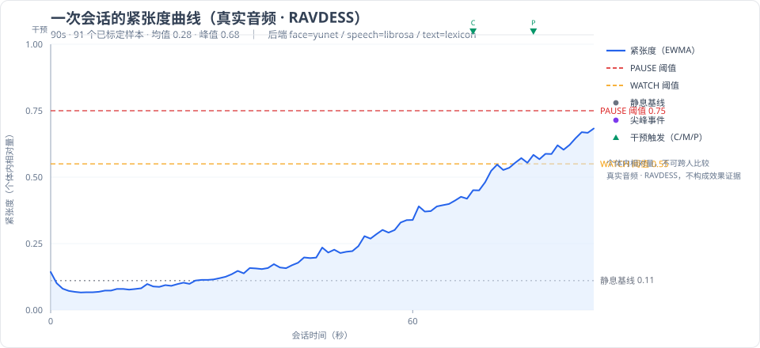

# 多模态情感计算系统（MVA）

[](LICENSE)
[](pyproject.toml)

> 一个**本地运行**、**可解释**、**多模态**的紧张度实时估计与短期预测系统，
> 带**跨会话记忆**与**分级干预行动**。用于高压任务中判断与改善人的可继续执行性。

数据流严格按五层顺序：**感知 → 快系统 → 轻量慢系统 → 记忆 → 行动**。

> CI 配置见 [`.github/workflows/ci.yml`](.github/workflows/ci.yml)：push 后自动在
> Python 3.10–3.13（Linux）+ Windows 3.12 上跑 157 项测试和端到端冒烟。

## 先看这三样（不用装环境）

| 想看什么 | 去哪看 |
|---|---|
| **系统输出长什么样** | 下面这张图 + [`examples/real-data-run/report.md`](examples/real-data-run/report.md)（**真实音频**跑出的一次会话复盘）+ [`examples/ravdess-audit/audit_report.md`](examples/ravdess-audit/audit_report.md)（对这批跑批的审核报告）+ [`dashboard.html`](examples/ravdess-audit/dashboard.html)（双击用浏览器打开） |
| **哪些需求真做了、哪些没做** | [`docs/05-implementation-status.md`](docs/05-implementation-status.md) —— 逐条需求 × 状态 × 代码位置 |
| **怎么自己验证这些说法** | `python -m pytest tests -q`（157 项）、`python scripts/demo_end_to_end.py`、`python scripts/check_environment.py` |



<sub>这张图是 `python scripts/export_demo_chart.py --episodes <episodes.jsonl> --episode-id ef18721606fb` 从**一次真实音频会话**导出的（RAVDESS，`face=yunet` / `speech=librosa` 都是真跑的）：紧张度曲线、两档阈值、静息基线、干预触发点（C/M/P 三种动作）。演员表演的语音不等于真实高压任务，所以这张图只说明"输出长这样"，**不是效果证据**。</sub>

---

## 0. 为什么做这个

想做这件事的直接原因，是现有两类工具都没解决同一个问题：

- **情绪/压力类产品**大多只给一个瞬时分数，没有记忆——每次打开都像第一次见你，
  更说不清"上次这个情境你是什么反应"；
- **科研侧的方案**则常常是高精度模型 + 黑箱，落到"这个人现在还能不能继续干活"这种
  具体决策上时，你没法解释为什么建议他休息。

所以这里反过来试一次：**不训练大模型**，只用可解释的统计方法（EWMA / Theil–Sen / CUSUM / OU 预测），
再加上一层真正会学习的记忆（阈值、基线、干预有效性都能回写并给出依据）。
验证的核心问题不是"准不准"——没有标注数据就不该谈准不准——而是
**这套闭环能不能跑通、每个结论能不能追溯到原因**。

也正因为这个立场，本仓库里所有"效果"相关的数字都被刻意标注为未验证（`UNVALIDATED`、`Forecast.validated=False`），
并且专门写了一层审核流水线来回答"到底哪一层出了问题"。这两件事是这个项目里最花心思的部分，
比任何指标都更能说明它不是一个演示玩具。

---

## 1. 这是什么 / 不是什么

**是：**

- 面部（MediaPipe / OpenCV DNN / Haar）+ 语音（librosa）+ 语义（情感模型 / 词典）
  三模态的**真实**感知接入，带完整降级链；
- 毫秒级**快系统**：即时紧张度、事件（尖峰/持续高位）检测；
- 秒~分钟级**轻量慢系统**：趋势、变点、短期预测、可继续性状态机（**不训练深度模型**）；
- **记忆层**：会话持久化、相似情境检索、复盘报告、个体画像回写；
- **行动层**：分级干预与迟滞控制，默认静默。

**不是（明确排除）：**

- ❌ 不是临床/医学诊断工具；
- ❌ 不提供心理学意义上的准确率数字（见 §6 诚实声明）；
- ❌ **不得**用于考核、评价、淘汰个人；
- ❌ 不做深度多模态融合、不做大规模被试泛化训练。

完整边界见 [`docs/01-requirements.md`](docs/01-requirements.md) §2。

---

## 2. 五层架构

```
   视频帧 ─┐   ┌──────────────────────────────────────────────────────────┐
   音频帧 ─┼─► │ ① 感知 ──► ② 快系统 ──► ③ 轻量慢系统 ──► ⑤ 行动 ──► 干预输出 │
   文本   ─┘   │  每帧        每帧          每 5s           每 5s           │
               │   │            │             │               ▲           │
               │   └────────────┴─────────────┘               │           │
               │                ▼                             │           │
               │        ④ 记忆（存储 / 检索 / 复盘 / 回写）──────┘           │
               └──────────────────────────────────────────────────────────┘
```

| 层 | 角色 | 节奏 | 关键实现 |
|---|---|---|---|
| ① 感知 | 原始信号 → 统一模态观测 | 每帧 | `perception/`（face / speech / text / fusion） |
| ② 快系统 | 即时紧张度 + 事件 | 每帧 | `fast_system/`（EWMA + 事件检测） |
| ③ 轻量慢系统 | 趋势 / 预测 / 可继续性 | 每 5s | `slow_system/`（Theil–Sen + CUSUM + OU 预测） |
| ④ 记忆 | 沉淀 / 检索 / 复盘 / 回写 | 1s 缓冲 / 会话末 | `memory/`（JSONL + 检索 + 报告） |
| ⑤ 行动 | 分级干预决策 | 5s / 事件触发 | `action/`（策略 + 迟滞 + 干预库） |

**横切关注点**——审核层（`audit/`）：不参与在线数据流，只在离线测试时
读五层产物做归因分析，回答"哪里有问题、哪里需要改"。见 §6。

详细设计见 [`docs/02-architecture.md`](docs/02-architecture.md)；
审核需求与设计见 [`docs/03-audit-requirements.md`](docs/03-audit-requirements.md)、
[`docs/04-audit-architecture.md`](docs/04-audit-architecture.md)。

---

## 3. 快速开始

### 3.1 安装

```powershell
# 最小依赖（numpy）即可跑通全流程（面部/语义会自动降级）
python -m pip install -e .

# 接入真实后端（推荐）
python -m pip install opencv-python mediapipe librosa sounddevice

# 可选：语义用 transformers 模型（需显式开启，见 §5）
python -m pip install transformers
```

国内网络建议加镜像：

```powershell
python -m pip install -i https://pypi.tuna.tsinghua.edu.cn/simple mediapipe librosa sounddevice
```

### 3.2 检查本机到底能跑什么

```powershell
python scripts/check_environment.py
```

它会打印每个依赖的可用性，并**实际装配一次**三模态传感器，告诉你真实生效的后端。

### 3.3 跑端到端演示

```powershell
python scripts/demo_end_to_end.py
```

演示会跑两次同类任务会话（合成信号），产物写在 `data/demo/`（**不会碰**你已有的会话数据），并验证：

- 产物落盘（`episodes.jsonl` / `index.jsonl` / `index.sqlite` / `profile.json` / `reports/*.md`）
- **跨会话记忆生效**（第 2 次会话的报告中出现历史对比，且检索命中会影响行动层决策）
- **个性化回写生效**（`profile.json` 的 `sessions`、`resilience`、`baseline_mu/sigma`、
  `theta_mid/theta_hi/tau_rev` 真被学习过，依据写在 `threshold_evidence` 里）
- **崩溃安全**（会话中途被杀，重启后残留检查点被标为 `aborted`，样本不丢）
- **隐私约束**（样本中不含任何原始音视频/文本字段；`notes` 只允许结构化短标签）

> 演示用的是**合成信号**，只验证管线连通性，**不能用于评估任何效果指标**。

### 3.4 单元测试

```powershell
python -m pytest tests -q
```

### 3.5 命令行

```powershell
# 业务管线
python -m emotion_computing.cli demo --duration 540 --task-outcome 0.7
python -m emotion_computing.cli episodes
python -m emotion_computing.cli report <episode_id>
python -m emotion_computing.cli clear --yes

# 记忆维护
python -m emotion_computing.cli profile          # 画像 + 阈值学习依据
python -m emotion_computing.cli index-health     # 缺字段旧索引告警
python -m emotion_computing.cli reindex          # 重建 index.jsonl + index.sqlite
python -m emotion_computing.cli delete <id> --yes
python -m emotion_computing.cli recover          # 崩溃残留 running → aborted

# 审核流水线（见 §7）
python -m emotion_computing.cli audit data --input dataset.json
python -m emotion_computing.cli audit run --config audit_input.json
python -m emotion_computing.cli audit dashboard <audit_id>
python -m emotion_computing.cli audit log --sample-id <id>
```

---

## 4. 感知后端与降级链

每个模态遵循 `首选 → 降级 → 合成兜底` 的装配链（`perception/base.py`），
**永不因缺依赖而崩溃**，且每次降级都如实体现在
`ModalityObservation.backend` 上，这样"系统到底跑了什么"永远可追溯。

| 模态 | 首选 | 降级 1 | 降级 2 | 兜底 |
|---|---|---|---|---|
| 面部 | MediaPipe FaceLandmarker（468 关键点） | OpenCV DNN YuNet（5 关键点） | OpenCV Haar | synthetic |
| 语音 | librosa 声学特征 | — | — | synthetic |
| 语义 | transformers 情感模型 | 中英焦虑词典 + 否定/程度规则 | — | synthetic |

### 本机实测结果（Python 3.13.5 / Anaconda，国内网络）

| 模态 | 实际生效后端 | 说明 |
|---|---|---|
| 面部 | `yunet` | 模型已下载（232 KB）；OpenCV DNN 真实运行 |
| 语音 | `librosa` | 声学特征真实运行 |
| 语义 | `lexicon` | transformers 未启用（需 `EC_ENABLE_TRANSFORMERS=1` + 下载权重） |

降级链实际为：`mediapipe → yunet → haar → synthetic`。

实测踩到、并已写进代码注释的三个版本坑：

1. **`mediapipe 1.1.0` 移除了 `mp.solutions`** —— 必须改用 Tasks API
   （`mediapipe.tasks.python.vision.FaceLandmarker`），并需要 `.task` 模型文件；
2. **`opencv-python 5.0.0` 的 `cv2` 没有 `CascadeClassifier`** —— OpenCV 5.x 移除了
   旧 objdetect API，Haar 路径不可用；但 `cv2.FaceDetectorYN`（DNN）仍保留，
   因此把 YuNet 插进了降级链；
3. **`storage.googleapis.com` 在国内网络直连超时** —— MediaPipe 模型需手动放入 `models/`。

### 真实音频跑批（不是合成信号）

用 RAVDESS（`Actor_01..03` 的**真实语音**，逐帧喂进 `SessionPipeline`）跑了 **26 个会话**，
`task_label=ravdess_real`，全部会话实际生效的后端都是
`face=yunet` / `speech=librosa` / `text=lexicon`。

| 指标 | 26 次真实音频会话的范围 |
|---|---|
| 紧张度均值 | 0.059 ~ 0.276 |
| 紧张度峰值 | 0.115 ~ 0.683 |
| 单会话样本数 | 26 ~ 118（每条语音片段长度不同） |

其中信号最丰富的一条（峰值 0.683、触发 2 次干预、跨会话对比 3 条）完整报告在
[`examples/real-data-run/report.md`](examples/real-data-run/report.md)。

> RAVDESS 是**演员按剧本表演**的语音，不是真实高压任务，更不是真人受试者。
> 这批跑批只能证明"真实信号 → 特征 → 融合 → 状态机 → 干预 → 复盘"这条链子在真实输入上不崩，
> **不构成任何效果证据**。边界写在 [`examples/real-data-run/README.md`](examples/real-data-run/README.md)。

### 需要下载的模型

```powershell
python scripts/download_models.py
```

该脚本会从多个镜像源自动回退下载：

| 文件 | 用途 | 大小 |
|---|---|---|
| `models/face_detection_yunet_2023mar.onnx` | OpenCV DNN 人脸检测 | ~230 KB |
| `models/face_landmarker.task` | MediaPipe FaceLandmarker | ~3.7 MB |

模型缺失只会让对应后端继续降级，不影响系统运行。

---

## 5. 接入真实视频 / 音频

感知层的三个传感器都接受统一的 `payload` 字典，只需按需喂数据：

```python
import cv2
from emotion_computing.config import Config
from emotion_computing.pipeline import SessionPipeline

pipe = SessionPipeline(config=Config(), data_dir="data", task_label="real_session")
print("生效后端：", pipe.backends())

cap = cv2.VideoCapture(0)
t = 0.0
while t < 300:
    ok, frame = cap.read()
    if not ok:
        break
    # payload 里带 frame 时走真实面部后端；不带则自动退回合成值
    pipe.step({"t": t, "frame": frame})
    t += 1.0 / 30.0

result = pipe.finalize(task_outcome=0.8)
print("复盘报告：", result["report_path"])
```

语音同理，传 `{"t": t, "audio": mono_float32_array, "sr": 16000}`；
语义传 `{"t": t, "text": "..."}`。

> 会话开始后的 `baseline_seconds` 秒是**静息基线期**，用于个体归一化。
> 请让受试者在此期间保持静息。

---

## 6. 审核流水线（MVA-Audit）

> 端到端指标全绿 **不等于** 每一层都准。审核层把 MVA 从"黑箱"改造成
> **模块可独立审计、失败可归因、改进可追踪**的透明流水线。
> 需求见 `docs/03-audit-requirements.md`，设计见 `docs/04-audit-architecture.md`。

### 6.1 它在回答什么问题

| 业务问题 | 对应能力 | 产物 |
|---|---|---|
| "这些测试数据本身可信吗？" | D-# 数据层审核 | `data_qa.json` |
| "是哪个模块出了问题？" | M-1 逐模块指标 / M-2 消融 | `module_evaluations.json` / `ablation_results.json` |
| "是哪个模态在误导融合？" | M-3 模态破坏者识别 | `modality_attributions.json` |
| "每条错误为什么错？" | F-1/F-2 七类失败归因 | `failure_cases.jsonl` / `failure_distribution.json` |
| "下一步该改哪里？" | I-1 修复优先级矩阵 | 报告中的"优先修复方向" |
| "谁能看懂并复核？" | V-1 可视化 + L-1 审核日志 | `dashboard.html` / `_audit_log.jsonl` |

### 6.2 七类失败归因（F-1）

| 失败类型 | 定义 | 定位到的模块 |
|---|---|---|
| `perception_failure` | 某模态特征提取错误 | ① 感知 |
| `modality_sabotage` | 某模态高置信度错误主导融合 | ① 感知 + 融合 |
| `slow_eval_failure` | 慢系统状态机判断方向错误 | ③ 慢系统 |
| `memory_interference` | 检索到不相关的历史案例 | ④ 记忆 |
| `action_failure` | 干预策略与情境不匹配 | ⑤ 行动 |
| `data_problem` | 金标准本身有误 | 数据层 |
| `combined_failure` | 各模块单独看都合理，组合出错 | 融合逻辑 |

### 6.3 快速跑一次

```powershell
# 用公开数据集（RAVDESS）跑一遍 MVA，再对其做审核
python scripts/audit_real_data.py
```

产物全部落在 `data/audit/audit_ravdess/<audit_id>/`：

```
audit_report.md              # 人工可读总报告（Markdown）
audit_report.json            # 机器可读副本
dashboard.html               # 单文件可视化（失败饼图/优先级柱图/模块雷达/失败清单）
data_qa.json                 # D-# 数据层审核原始数据
module_evaluations.json      # M-1 各模块指标
ablation_results.json        # M-2 消融实验
modality_attributions.json   # M-3 每样本模态归因
failure_cases.jsonl          # F-1 每个错误样本的归因（一行一条）
failure_distribution.json    # F-3 失败分布 + 修复优先级
```

跨迭代历史 `data/audit/_iterations.jsonl`、审核日志 `data/audit/_audit_log.jsonl`
同样是追加写的纯文本，可直接用编辑器核查。

### 6.4 接入你自己的数据

审核层只读 MVA 产物，**零侵入**——业务代码不需要任何改动。核心接口：

```python
from emotion_computing.audit import AuditRunner, AuditRunnerConfig
from emotion_computing.audit.module_evaluator import MVASampleOutput
from emotion_computing.contracts import GoldDataset, GoldLabel

dataset = GoldDataset(name="my_task", samples=(
    GoldLabel(sample_id="s1", modality_labels={"face": 0.3, "speech": 0.7, "text": 0.5},
              stress=0.55, state="WATCH", action_appropriateness=4,
              annotator_id="r1"),
    # ...
))
outputs = [
    MVASampleOutput(sample_id="s1", stress=0.60, state="WATCH", action="coach",
                    modality_scores={"face": 0.4, "speech": 0.8, "text": 0.5},
                    modality_confidence={"face": 0.8, "speech": 0.9, "text": 0.6}),
    # ...
]
runner = AuditRunner(AuditRunnerConfig(output_dir="data/audit"))
report = runner.run(dataset, outputs)
print(report.failure_distribution.top_repair)  # 下一步该改什么
```

### 6.5 关键诚实约束

- 标注一致性 `Krippendorff α < 0.67` 时，流水线**主动中止**，不进入模块评估——
  因为金标准本身不可信时，任何模型指标都没有意义；
- 所有判定阈值（`error_theta`、`theta_saboteur` 等）都是**启发式初值**，
  需按任务校准，报告中会连同配置一并落盘，保证可复现。

---

## 7. 诚实声明（重要，请勿删除）

> - 本系统输出的紧张度是**个体内相对量**：可在同一次会话的不同时刻之间比较，
>   **不支持**跨人比较，也不是心理学/医学意义上的测量结果。
> - 短期预测（OU + 趋势外推）**未经真实数据回测**，代码中 `Forecast.validated`
>   恒为 `False`。**不要**对外给出本系统的"预测准确率"。
> - 所有特征阈值与权重都是**启发式初值**，需在真实使用中按个体校准。
> - 本系统不提供诊断结论，**不得**用于考核、评价或淘汰个人。

代码层面同样强制：`emotion_computing.UNVALIDATED` 常量、`Forecast.validated=False`、
复盘报告末尾的免责段落，都是这条约束的落地。

---

## 8. 关键算法一览

| 环节 | 方法 | 为什么这样选 |
|---|---|---|
| 个体归一化 | σ 收缩 + sigmoid：`σ_eff=√(σ²+σ_prior²)` | 静息期 30s 估出的 σ 天然极小，直接 z-score 会让输出饱和到 1.0 |
| 多模态融合 | 加权平均 `Σw·c·s / Σw·c` | 缺失模态的权重**自然**从分母消失，无需特殊分支 |
| 快系统平滑 | 时间感知 EWMA `α=1-e^{-Δt/τ}` | 不同帧率下行为一致，可复现 |
| 趋势 | Theil–Sen 成对斜率中位数 | 对离群尖峰稳健，不会被单点带偏 |
| 变点 | CUSUM（基线取前 25% 样本） | 区分"正常波动"与"持续性偏移" |
| 短期预测 | `Ŝ(t+H)=S_t+slope·H+(μ_base−S_t)(1−e^{−H/τ})` | 均值回复 + 趋势外推，可解释、在线自适应、无需训练 |
| 行动决策 | 状态机 + 冷却迟滞 | 防止阈值附近抖动式反复提示 |

---

## 9. 目录结构

```
emotion-computing/
├── .github/workflows/ci.yml     # CI：3.10–3.13 × Linux + 一个 Windows job
├── docs/
│   ├── 01-requirements.md      # 需求文档（唯一需求依据）
│   ├── 02-architecture.md      # 架构设计（契约/算法/时序/降级）
│   ├── 03-audit-requirements.md
│   ├── 04-audit-architecture.md
│   ├── 05-implementation-status.md  # ★ 需求实现状态矩阵（哪些做了、哪些没做）
│   └── assets/                 # README 用图
├── examples/                   # ★ 真实产物样例（不用跑就能看）
│   ├── real-data-run/          #   真实音频驱动的一次会话复盘
│   └── ravdess-audit/          #   一次 RAVDESS 跑批的审核报告 + dashboard
├── src/emotion_computing/
│   ├── contracts.py            # ★ 全部跨层数据契约（含审核层）
│   ├── config.py               # 配置与个体画像（原子写 + 损坏备份）
│   ├── perception/             # ① 感知
│   ├── fast_system/            # ② 快系统
│   ├── slow_system/            # ③ 轻量慢系统
│   ├── memory/                 # ④ 记忆（JSONL 日志 + SQLite 索引 + 隐私门）
│   ├── action/                 # ⑤ 行动
│   ├── audit/                  # ★ 审核流水线（D/M/F/V/I/L 六大需求）
│   │   ├── metrics.py          #   指标：CCC/RMSE/F1/Krippendorff α
│   │   ├── data_audit.py       #   D-# 数据层审核
│   │   ├── module_evaluator.py #   M-1/M-2 逐模块评估 + 消融
│   │   ├── modality_diagnostic.py  # M-3 模态破坏者识别
│   │   ├── failure_attribution.py  # F-1/F-2/F-3 七类失败归因
│   │   ├── log.py              #   L-1 审核日志与追溯
│   │   ├── report.py           #   Markdown/JSON 报告
│   │   ├── viz.py              #   V-1 单文件可视化 dashboard
│   │   └── runner.py           #   审核流水线编排
│   ├── pipeline.py             # 五层编排
│   └── cli.py                  # 命令行（含 audit 子命令）
├── scripts/
│   ├── check_environment.py    # 探测本机可用后端
│   ├── download_models.py      # 下载模型权重（多源回退）
│   ├── demo_end_to_end.py      # 端到端演示（含断言）
│   ├── export_demo_chart.py    # 导出 README 那张曲线图（纯 SVG，无额外依赖）
│   ├── validate_real_data.py   # 公开数据集驱动的真实数据验证
│   └── audit_real_data.py      # 真实数据审核流水线
├── tests/                      # 单元测试（157 项）
├── models/                     # 模型权重（可选，已 gitignore）
└── data/                       # 运行时产物（已 gitignore）
```

---

## 10. 隐私与伦理

- **本地处理**：不联网、不上传；
- **不落盘原始数据**：`Episode.samples` 结构里**不存在**任何原始视频/音频/文本字段，
  只有特征与统计量；
- **审核产物同样不落盘原始信号**：`failure_cases.jsonl` 只记录样本 ID、
  误差、归因类型与模态分数，不含任何原始帧/波形/文本；
- **一键删除**：`python -m emotion_computing.cli clear --yes`；
- **可关闭干预**：行动层默认静默，只在必要时提示。

---

## 11. 后续路线

已经做完的（留在这里是为了让路线图看得出进度，而不是永远不动的许愿池）：

- [x] 记忆层：阈值/基线真正自适应回写 + SQLite 索引 + 崩溃检查点
- [x] 记忆回流到决策（不再只写进复盘报告）
- [x] 慢系统输出主导模态归因（L-5）

还没做的：

- [ ] 用真实标注数据校准特征阈值与融合权重（解除 `UNVALIDATED`）；
- [ ] 预测模型回测（MAE / 方向准确率）；
- [ ] ASR 接入（faster-whisper）提升语义模态覆盖率（P-5，当前语义只吃外部文本）；
- [ ] 更丰富的面部 AU 特征（需要更多人脸关键点或专门的 AU 模型）；
- [ ] 严格的逐周期 shimmer（现在是帧级振幅微扰代理，见 P-3）；
- [ ] 干预有效性的多会话 A/B 跟踪；
- [ ] 审核层：人工修正回写闭环（`AuditLogEntry.human_attribution` → 自动重算指标）。

---

## 12. 许可证与数据声明

- 代码：[MIT](LICENSE)。
- `examples/` 里的产物是本系统自己生成的派生结果，随代码一并 MIT。
- 仓库**不分发**任何公开数据集的原始音频；脚本引用的 RAVDESS 数据集遵循其自身的
  CC BY-NC-SA 4.0（仅限非商业研究），请从官方渠道获取并遵守其条款。
- 模型权重不入库，由 `scripts/download_models.py` 从上游下载，遵循各自上游许可。

> 本项目**没有**采集、也没有分发任何真人受试者的数据；
> 所有示例会话都是合成驱动或公开表演数据集，不涉及个人隐私数据。
